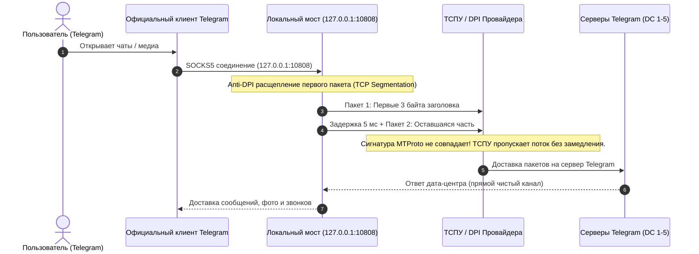

# Telegram-Invisible-Bridge

**Telegram-Invisible-Bridge** — это сверхлегковесный автономный локальный микро-мост для Telegram, разработанный для обхода блокировок и замедления ТСПУ (DPI) в РФ **без использования системного VPN**.



---

## Главные преимущества перед обычными VPN и MTProto

1. **Банки и Госуслуги работают на 100%:** Приложение **не использует Android VpnService**. В строке состояния нет значка «ключа VPN». Сбербанк, Т-Банк, Госуслуги, Ozon и Wildberries не выдают ошибок и не требуют ввода капч.
2. **Официальный Telegram с надежными Push-уведомлениями:** Не нужно ставить сомнительные пересобранные APK. Вы продолжаете пользоваться оригинальным официальным клиентом Telegram из Google Play — все звонки и уведомления приходят мгновенно.
3. **Обход ТСПУ без сторонних серверов:** Обычные публичные MTProto-прокси блокируются за пару часов по сигнатурам пакетов. Telegram-Invisible-Bridge локально расщепляет первые байты TCP-рукопожатия на лету, сбивая с толку анализаторы DPI.
4. **Подключение в 1 клик:** Настройка официального Telegram выполняется по встроенной ссылке в одно касание.
5. **Нулевой расход батареи:** В фоновом режиме потребляет менее 15 МБ оперативной памяти и 0% процессора.

---

## Способы запуска

### Вариант 1. Android-приложение (APK)
1. Установите `TG-Bridge.apk` на телефон.
2. Откройте приложение и убедитесь, что переключатель **«Статус службы»** включен (зеленый индикатор).
3. Нажмите кнопку **«ПОДКЛЮЧИТЬ К TELEGRAM В 1 КЛИК»**.
4. В открывшемся официальном Telegram нажмите **«Включить»** (или «Включить этот прокси»).
5. Нажмите кнопку **«Разрешить автозапуск и фоновую работу»** в приложении, чтобы система не выгружала мост из памяти.

---

### Вариант 2. Запуск через Python (Компьютер / Termux на телефоне)
Если вы хотите запустить мост на компьютере или в консоли Termux на Android:

```bash
python tg_bridge.py
```

После запуска откройте в Telegram ссылку:
```text
tg://socks?server=127.0.0.1&port=10808
```
И нажмите кнопку **«Включить»**.

---

## Ручная настройка прокси в Telegram

Если ссылка не открылась автоматически, прокси можно добавить вручную:
1. В Telegram перейдите: **Настройки ➔ Данные и память ➔ Прокси**.
2. Нажмите **Добавить прокси**.
3. Выберите тип: **SOCKS5**.
4. Введите параметры:
   * **Сервер:** `127.0.0.1`
   * **Порт:** `10808`
   * Поля «Имя пользователя» и «Пароль» оставьте пустыми.
5. Нажмите галочку сохранения в правом верхнем углу.

---

## Сборка проекта из исходников

Проект собирается с помощью Gradle и Android Studio:
```bash
./gradlew assembleRelease
```
Готовый установочный файл появится в `app/build/outputs/apk/release/`.
